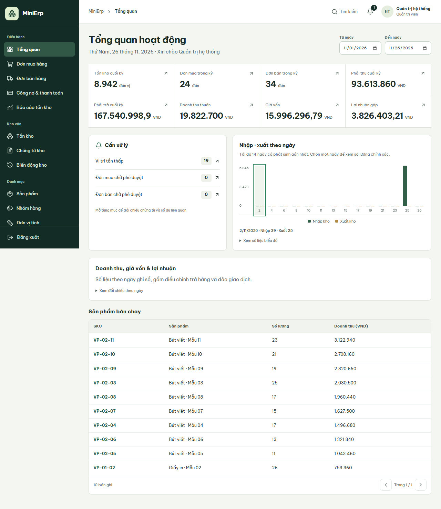
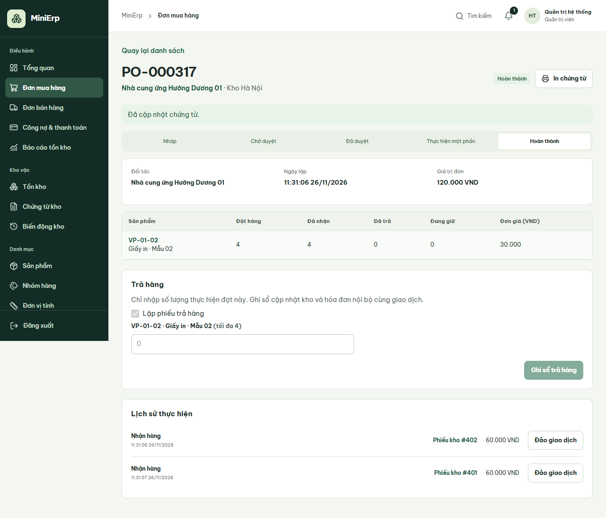

# MiniErp

A Vietnamese operations application for small distributors. It uses a .NET 10 modular monolith, SQL Server 2022 and a React/TypeScript client. The goal is to trace operational documents, inventory and internal finance from the same underlying records.

Trace a purchase receipt or a sales shipment from its approved order through the stock ledger, internal invoice and cash allocation. The Vietnamese dashboard uses posted SQL Server records, including returns and corrections. [Tiếng Việt](README.vi.md) · [Verification](docs/TEST_REPORT.md) · [Handover](docs/HANDOVER.md)

## Available workflows

Purchase orders, sales orders and standalone stock drafts support version-checked edits. Reviewers can return an order for revision or reject it with a recorded reason. Document history identifies the actor for each step. Open orders past the promised date appear in the dashboard queue. [Workflow and approval rules](docs/BUSINESS_WORKFLOWS.md)

V2 milestone 1 adds read-only stock and financial discrepancy reports, source-level sales cost snapshots and Vietnam business-day cutoffs. Open **Báo cáo tồn kho → Đối soát hiện tại** or **Công nợ & thanh toán → Đối soát** on the seeded preview. [V2 roadmap](docs/UPGRADE_V2_PLAN.md) · [Permissions](docs/API_PERMISSION_MATRIX.md)

- Sign in, refresh a session, change a password and administer accounts, roles and permission grants.
- Search, filter, create, edit and deactivate catalog and partner records.
- Draft, post and reverse receipts, issues, transfers, adjustments and counts. View stock balances, low-stock positions and movements with their recorded costs.
- Approve purchase and sales orders, reserve available stock, post partial receipts or shipments, return goods and inspect the order timeline.
- Track internal receivables and payables, split payments across invoices, refund cash-backed credits, age balances and reconcile allocations.
- Filter stock and sales reports by date, search by SKU or document, read permission-scoped alerts and audit events, exchange product workbooks and print order documents to PDF.

| Operations dashboard | Purchase order |
| --- | --- |
|  |  |

## Local setup

From D:/ReactJS/MiniErp in PowerShell:

~~~powershell
.\scripts\check-environment.ps1
.\scripts\setup.ps1
.\scripts\migrate-db.ps1
.\scripts\seed-demo.ps1
.\scripts\start-dev.ps1
~~~

Open the [application](http://localhost:5186). The development seed creates admin@minierp.example using the password in the local, ignored .work/dev.env.json. OpenAPI is available at [openapi/v1.json](http://127.0.0.1:5168/openapi/v1.json). Use scripts/stop-dev.ps1 to stop this project's two development processes. The database is retained.

## Architecture and tests

- [Architecture](docs/architecture/ARCHITECTURE.md) and [database ERD](docs/diagrams/ERD.md)
- [Deployment and configuration](docs/DEPLOYMENT.md), [API](docs/API_DOCUMENTATION.md) and [security](docs/SECURITY.md)
- [Actual build and test results](docs/TEST_REPORT.md) and [known issues](docs/KNOWN_ISSUES.md)
- [Repository references](docs/REPOSITORY_REFERENCES.md) and [.NET skill inventory](docs/SKILLS_INVENTORY.md)
- [Purchasing, sales and warehouse demos](docs/DEMO_GUIDE.md), [SQL performance](docs/SQL_PERFORMANCE.md), [CV notes](docs/interview/CV_PROJECT.md) and [interview questions and exercises](docs/interview/README.md)

Run scripts/test-all.ps1 to use the isolated MiniErp_Test database and check the frontend. Add -Browser after setting up the running development services to exercise the real UI with Playwright.

## License

MiniErp is provided under the [MIT license](LICENSE). See the [repository references](docs/REPOSITORY_REFERENCES.md) for third-party attribution.
