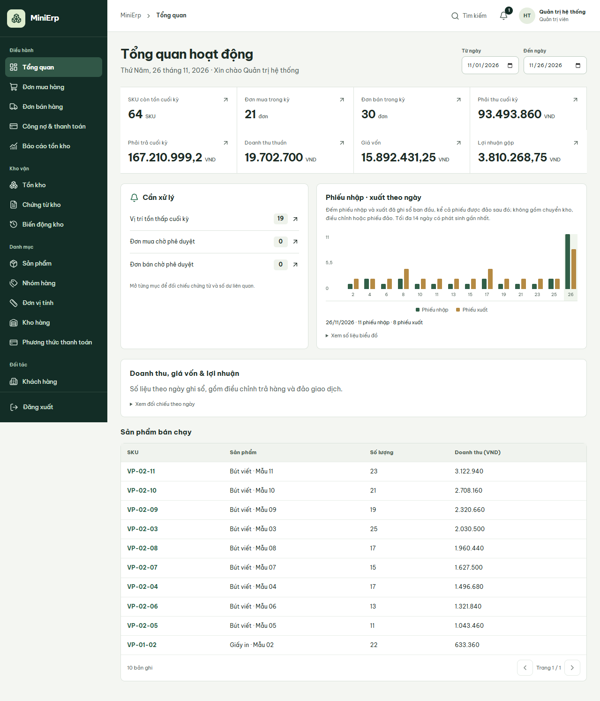

# MiniErp

Khi duyệt đơn bán, MiniErp so sánh tổng nợ hóa đơn và cam kết chưa giao với hạn mức của khách hàng. Hạn mức 0 là không giới hạn. Người có quyền duyệt vượt mức phải ghi lý do. Kế toán được cấp quyền đảo phiếu có thể sửa sai khoản thu, chi hoặc hoàn tiền và tra tác động trên sao kê theo ngày. [Quy tắc tài chính](docs/FINANCE.md)

Mở **Công nợ & thanh toán → Lịch sử đối tác**, chọn **Công ty Phân phối Minh An**. Sau lần giao một phần từ **Kho mô phỏng tín dụng** (`DEMO-TD`) và điều chỉnh phiếu thu, khách còn nợ 360.000 đồng, có 120.000 đồng cam kết chưa giao và còn 20.000 đồng hạn mức. [Hướng dẫn demo](docs/DEMO_GUIDE.md)

Ứng dụng cho doanh nghiệp phân phối, dùng ASP.NET Core 10, SQL Server và React. Một lần nhận hàng hoặc giao hàng cập nhật đồng thời đơn, số dư kho, sổ kho và hóa đơn nội bộ. Bộ phận tài chính có thể phân bổ tiền theo hóa đơn, theo dõi tuổi nợ và đối soát đến chứng từ nguồn. [Bàn giao](docs/HANDOVER.md) · [Kết quả kiểm thử](docs/TEST_REPORT.md)

V2 bổ sung đối soát theo từng vị trí kho và chứng từ tài chính, giá vốn theo dòng bán và mốc chốt ngày Việt Nam. Mở **Báo cáo tồn kho → Đối soát hiện tại** hoặc **Công nợ & thanh toán → Đối soát** để thử. [Kế hoạch V2](docs/UPGRADE_V2_PLAN.md) · [Quyền theo API](docs/API_PERMISSION_MATRIX.md)

**Thử luồng duyệt** trong mục Đơn mua hoặc Đơn bán. Nhập ngày giao/nhận dự kiến, gửi duyệt, rồi dùng tài khoản quản lý khác để yêu cầu sửa. Sửa đơn nháp, gửi lại và xem lý do cùng người xử lý trong lịch sử. Khi đơn đã duyệt, có thể giao hoặc nhận từng phần và theo dõi công nợ từ chứng từ nguồn. [Quy trình và quyền duyệt](docs/BUSINESS_WORKFLOWS.md)

Trong D:/ReactJS/MiniErp, chạy:

~~~powershell
.\scripts\setup.ps1
.\scripts\migrate-db.ps1
.\scripts\seed-demo.ps1
.\scripts\start-dev.ps1
~~~

Truy cập [MiniErp](http://localhost:5186). Email demo là admin@minierp.example. Mật khẩu được sinh riêng khi khởi tạo và lưu trong .work/dev.env.json. Dùng scripts/stop-dev.ps1 để dừng tiến trình của dự án.

Seed tạo 100 đơn mua và 200 đơn bán trong sáu tháng giao dịch mô phỏng. Các lần nhập, xuất, trả và thanh toán đều đi qua dịch vụ nghiệp vụ. Chạy lại seed giữ nguyên lịch sử đã ghi. [Hướng dẫn demo](docs/DEMO_GUIDE.md) · [README tiếng Anh](README.md) · [Bài tập phỏng vấn](docs/interview/README.md)
