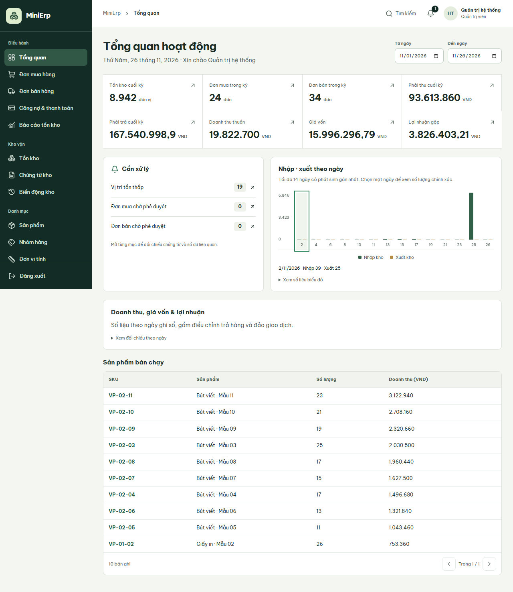

# MiniErp

Ứng dụng cho doanh nghiệp phân phối, dùng ASP.NET Core 10, SQL Server và React. Một lần nhận hàng hoặc giao hàng cập nhật đồng thời đơn, số dư kho, sổ kho và hóa đơn nội bộ. Bộ phận tài chính có thể phân bổ tiền theo hóa đơn, theo dõi tuổi nợ và đối soát đến chứng từ nguồn. [Bàn giao](docs/HANDOVER.md) · [Kết quả kiểm thử](docs/TEST_REPORT.md)

**Thử luồng nghiệp vụ** trong mục Đơn mua hoặc Đơn bán. Chọn đối tác, gửi duyệt và nhập hoặc giao một phần. Từ dòng thực hiện, mở phiếu kho, kiểm tra công nợ và ghi thanh toán. Có thể tra cứu sản phẩm bằng SKU, nhập và xuất danh mục Excel, rồi dùng chức năng in của trình duyệt để lưu PDF.

Trong D:/ReactJS/MiniErp, chạy:

~~~powershell
.\scripts\setup.ps1
.\scripts\migrate-db.ps1
.\scripts\seed-demo.ps1
.\scripts\start-dev.ps1
~~~

Truy cập [MiniErp](http://localhost:5186). Email demo là admin@minierp.example. Mật khẩu được sinh riêng khi khởi tạo và lưu trong .work/dev.env.json. Dùng scripts/stop-dev.ps1 để dừng tiến trình của dự án.

Seed tạo 100 đơn mua và 200 đơn bán trong sáu tháng giao dịch mô phỏng. Các lần nhập, xuất, trả và thanh toán đều đi qua dịch vụ nghiệp vụ. Chạy lại seed giữ nguyên lịch sử đã ghi. [Hướng dẫn demo](docs/DEMO_GUIDE.md) · [README tiếng Anh](README.md) · [Bài tập phỏng vấn](docs/interview/README.md)
